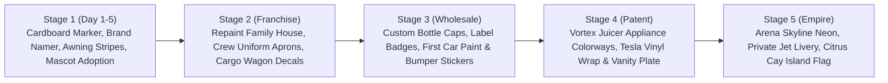

# 🍋 Universal Lemonade: Kid-Centric GUI Masterplan & Asset Manifest

## 1. Executive Summary & Design Vision

The gameplay engine of *Universal Lemonade* is mathematically sound, educational, and deeply engaging. However, the current harness is a text-heavy telemetry dashboard. 

The goal of this visual overhaul is to transform the game into a **delightful, tactile, illustrated toy** that an 8-to-12-year-old kid will immediately fall in love with on a phone or tablet, while maintaining the clean, satisfying mechanical depth of *Universal Paperclips*.

### Core Principles
1. **Ultra-Lightweight Asset Footprint:** Fast load (<1.5s on mobile 4G), total bundle size under 1.5MB, crisp rendering on high-DPI displays.
2. **Tactile Cause-and-Effect:** When you change the recipe, you *see* the lemonade change color in the pitcher. When it's hot, you *see* the sun glaring and ice melting.
3. **Deep Personal Agency:** Kids love ownership. Letting them pick their house color, name their brand, and choose a stand canopy or mascot turns a numbers game into *their personal story*.
4. **Information Without Intimidation:** Replace spreadsheet telemetry with intuitive visual metaphors (thermometers, smiling customer thought bubbles, liquid volume bars) while keeping exact stats accessible for kids who love the math.

---

## 2. Screen Architecture (Mobile Portrait First)

On mobile portrait mode (primary target), the screen is divided into three distinct zones:

```
┌──────────────────────────────────────────────┐
│  HEADER: Brand Name, Cash Bar, Day Ticker    │
├──────────────────────────────────────────────┤
│                                              │
│  ZONE 1: THE LIVING DIORAMA (Top ~35%)       │
│  • Illustrated backdrop evolving by stage    │
│  • Animated weather & sky                    │
│  • The Stand & customized house              │
│  • Walking customer avatars / emoji moods    │
│                                              │
├──────────────────────────────────────────────┤
│                                              │
│  ZONE 2: THE WORKBENCH / TOY (Middle ~40%)   │
│  • Interactive Lemons, Sugar, Ice dials      │
│  • The Glass Pitcher (liquid level & color)  │
│  • Price Tag dial with elasticity smiley     │
│  • Big Green "OPEN FOR BUSINESS" Lever       │
│                                              │
├──────────────────────────────────────────────┤
│                                              │
│  ZONE 3: DRAWER & TABS (Bottom ~25%)         │
│  [🧹 Chores] [🏘️ Franchise] [📦 Wholesale]  │
│  [🏆 Trophy Shelf] [📜 Executive P&L Log]    │
│                                              │
└──────────────────────────────────────────────┘
```

---

## 3. Paced Milestone Personalization Roadmap

Rather than front-loading a tedious 5-step form before Day 1, personalizations unlock as celebratory milestone rewards across the journey. A **🎨 Customize Closet** palette button remains permanently accessible on the stand so kids can experiment and switch styles anytime:



### Stage-by-Stage Unlocks:
1. **Stage 1 (Driveway):**
   - **Day 1:** Raw cardboard box & crayon sign (`LEMONAD 50¢`).
   - **First $30 (Wooden Stand):** Name the Brand + Choose Striped Awning Fabric (Sunny Yellow/White, Watermelon Pink/Green, Cosmic Star Blue, Rainbow).
   - **Day 5 (Visitor Event):** Adopt companion mascot (**Buster** the golden pup, **Mittens** the calico cat, or **Peppy** the cockatiel) + pick their custom bandana color.
2. **Stage 2 (Franchise):**
   - **First $250 Milestone:** *"Mom and Dad say you can help pick the new house color!"* Choose house wall siding & front door trim.
   - **Hiring Crew:** Pick team apron and baseball cap colors for Timmy, Leo, and Sarah.
   - **Radio Flyer Wagon:** Pick flame decals, lightning bolts, or racing stripes.
3. **Stage 3 (Wholesale):**
   - **Bottle Studio:** Pick bottle crown cap color (Metallic Gold, Electric Lime, Cherry Red) and label badge shape (Comic Starburst, Vintage Oval, Modern Diamond).
   - **First Car (Used Honda Civic):** Choose paint job (Canary Yellow, Rally Blue, Cherry Red) and funny bumper sticker (*"HONK IF YOU LOVE LEMONS"*).
4. **Stage 4 (Patent / Tech):**
   - **Vortex Press Appliance Colorway:** Brushed Stainless Gold, Retro Mint, Glossy Lemon Yellow, or Matte Stealth Black.
   - **Tesla Model X Wrap & Vanity Plate:** Cyber Chrome or Matte Yellow + custom 7-character plate (`LEM0N8`, `JUICY`).
5. **Stage 5 (Empire / Island):**
   - **The Lemonade Center Arena:** Glowing rooftop neon colors lighting up downtown.
   - **Gulfstream G650 Private Jet:** Yellow-and-black luxury racing stripe livery.
   - **Citrus Cay Island:** Beach cabana umbrella colors and custom island flag crest (Crowned Lemon, Dolphin, Palm Tree, Sunrise).

---

## 4. Visual Scale Architecture: The "Powers of Ten" ("WOW THAT'S SO MUCH MORE!")

A 9-year-old cannot easily picture the difference between `1,000` and `100,000` as raw numbers on a screen. But kids immediately grasp **physical unit elevation and visual density**:

### A. The Unit Elevation Ladder (From Cups to Cargo Ships)
Every stage visually replaces the unit of production with an order-of-magnitude larger physical container:

| Business Tier | Visual Physical Unit | What 1 Unit Represents | On-Screen Graphic & Animation |
| :--- | :--- | :--- | :--- |
| **Tier 1 (Driveway)** | 🥛 **Paper Cup** | 1 Single Cup | Hand-poured glass, individual ice cubes bobbing |
| **Tier 2 (Kitchen/Franchise)** | 🏺 **Glass Pitcher** | 10 Cups | Full glass pitcher bubbling with floating lemon wheels |
| **Tier 3 (Wholesale Garage)** | 📦 **Wooden Crate** | 24 Glass Bottles | Stacks of wooden crates piled up in the garage |
| **Tier 4 (Club Store / Factory)**| 🪵 **Industrial Pallet** | 50 Crates (1,200 bottles) | Giant wooden forklift pallet wrapped in clear plastic |
| **Tier 5 (Regional Supply)** | 🚛 **18-Wheeler Semi-Truck** | 24 Pallets (28,800 bottles) | Heavy diesel semi-truck backing up with air-brake hiss |
| **Tier 6 (Global Conglomerate)**| 🚢 **Ocean Cargo Freighter** | 500 Containers (14M bottles)| Massive ocean freighter ship sailing past tropical islands |

*The "Drop" Micro-Animation:* When a kid orders supplies in Stage 5, instead of a number incrementing, a **cartoon forklift drops an entire shrink-wrapped wooden pallet onto the screen with a heavy screen-shake and comic dust puff (`THUD!`)**.

### B. The Diorama Camera Pullback (Zooming Out Across the World)
The top 35% diorama physically pulls its camera back as you advance through stages:
1. **Stage 1 (Macro View):** Camera is 3 feet from the wooden stand. You see individual wood knots, the sweating pitcher, Buster chewing a tennis ball.
2. **Stage 2 (Neighborhood Birds-Eye):** Camera pulls back to an aerial view of the suburban cul-de-sac. Dotted bike trails connect your house to Timmy's stand, Leo's ballpark stand, and Sarah's pool stand.
3. **Stage 3 (Street & Garage Level):** Camera focuses on the garage loading door. The Honda Civic trunk is packed full of bottle crates, with neighborhood delivery vans rolling out.
4. **Stage 4 (City Skyline):** High-rise downtown office overlooking the city. Highways with bustling delivery trucks, billboards featuring your "Vortex Press" juicer.
5. **Stage 5 (Global Map & Island):** Stylized globe/ocean view with shipping sea-lanes, flight paths of your yellow jet, and your private tropical island Citrus Cay glistening in turquoise waters.

### C. Tactile Money Scaling (Coins to Cash Briefcases)
Watching wealth accumulate must feel physically heavy and visceral:
* **Stage 1 ($1 - $100):** Individual shiny gold coins clink one by one into an open glass mason jar (`clink! clink! clink!`).
* **Stage 2 ($100 - $1,000):** Coins pour in a continuous green-and-gold waterfall into a heavy metal lockbox.
* **Stage 3 ($1,000 - $10,000):** Thick banded paper stacks of $100 bills slam onto a wooden desk.
* **Stage 4 ($10,000 - $1,000,000):** High-speed digital ledger ticker with green neon bank wire-transfer pings.
* **Stage 5 ($1,000,000+):** Heavy canvas bank bags with dollar signs and shiny gold bars dropping into a vault.

---

## 5. Tactile Interactive Elements (Zero-Weight SVG & CSS)

Instead of sterile HTML input boxes, gameplay interactions feel like physical wooden and glass toys:

### 1. The Dynamic Lemonade Pitcher
* **Visual Liquid Level:** SVG beaker that fills dynamically as pitchers are mixed.
* **Liquid Color Tint:** 
  - Perfect Recipe (4L, 4S): Rich golden citrus yellow `#FFD700`.
  - Too Sour (8L, 1S): Neon acidic greenish-yellow `#CCFF00`.
  - Too Sweet (1L, 8S): Deep syrupy amber `#FFA500`.
  - Watery (low lemons): Pale translucent yellow `#FFFACD`.
* **Floating Physics:** 2–3 lemon slices and ice cube cubes bob with gentle CSS float animations.

### 2. The Weather Window
* A miniature round ship's porthole or curved window showing the sky.
* **Sunny (85°F+):** Pulsing golden lens flare, gentle heat shimmer.
* **Cloudy (72°F):** Drifting fluffy cartoon clouds.
* **Rainy (60°F):** Animated CSS raindrop streaks on the glass and miniature puddles.

### 3. Customer Mood Bubbles
When the simulation runs, animated 2D customer silhouettes walk past the stand:
* Satisfied customer: Pops a thought bubble with `😍 🍋 💯` and drops floating green coins (`+$2.50`).
* Too expensive: Thought bubble with `💸 😠` and walks past.
* Too lukewarm: Thought bubble with `🥵 🧊❓` (needs ice!).

---

## 5. Frontier AI Image Asset Pipeline & Manifest

To keep the game feather-light while delivering an eye-popping modern visual identity, we use a **Pop Comic Vector & Layered 2.5D approach**:
1. **Pre-rendered AI Backgrounds:** Ultra-compressed WebP hero plates (80–120KB each) styled with bold ink outlines and cel-shaded cartoon palettes.
2. **Pop-Comic Vector SVG Foreground Elements:** Chunky black borders (`3px solid #1e293b`), solid drop shadows (`box-shadow: 4px 4px 0 #0f172a`), candy-saturated palette, and bouncy squash-and-stretch button micro-animations.

### Pop-Comic Color Palette
- **Citrus Sunshine (Primary):** `#FFDE00`
- **Pop Mint Green (Success/Profits):** `#10B981`
- **Punchy Berry / Coral (Expenses/Alerts):** `#F43F5E`
- **Electric Sky (Weather/Water):** `#0EA5E9`
- **Ink Navy (Comic Outlines & Text):** `#0F172A`
- **Crisp Cream Paper (Card Backgrounds):** `#FEFCE8`

### Asset Manifest & Prompt Guide

#### A. Hero Stage Backdrops (1080 x 1920 portrait, 9:16 mobile)
Generate in Midjourney / Imagen 3 / DALL-E 3 with the **Pop Comic Style Directive**:
`Vibrant 2D pop-comic illustration, bold clean ink outlines, cel-shaded bright colors, playful Saturday-morning cartoon style, sunny cheerful atmosphere, minimal clutter, Nintendo video game aesthetic, clean mobile backdrop --ar 9:16`

1. **Stage 1 (The Driveway Stand):**
   > *Prompt:* `Vibrant 2D pop-comic illustration of a suburban front yard and driveway, sunny blue sky, fluffy white clouds, green lawn with yellow dandelions, wooden picket fence, cozy cartoon house with solid flat siding color, bright cheerful morning, bold ink outlines, cel-shaded colors, clean cartoon mobile game background --ar 9:16`
2. **Stage 2 (Neighborhood Cul-de-Sac & Park):**
   > *Prompt:* `Vibrant 2D pop-comic cartoon illustration of a lively suburban cul-de-sac and community park, cartoon kids riding colorful bikes, sidewalks, distant swimming pool fence and ballpark bleachers, sunny summer noon, playful comic book style, bold ink lines, saturated colors --ar 9:16`
3. **Stage 3 (The Bottling Garage & Urban Bodega Row):**
   > *Prompt:* `Vibrant 2D pop-comic illustration of a colorful open-door garage bottling workshop, glass bottles on conveyor, crates of lemons, opening up to a bustling comic city sidewalk with corner bodegas and market awnings, bright afternoon sun, bold line art, cartoon game art --ar 9:16`
4. **Stage 4 (The Innovation Lab & High-Rise Studio):**
   > *Prompt:* `Fun 2D pop-comic illustration of a bright sunlit citrus engineering design lab, high-rise floor-to-ceiling windows overlooking a colorful cartoon city skyline, blueprints of juicer inventions on easels, bright yellow accents, playful futuristic comic aesthetic --ar 9:16`
5. **Stage 5 (Citrus Cay Private Tropical Island):**
   > *Prompt:* `Magnificent cartoon 2D pop-comic illustration of a tropical private Caribbean island, turquoise ocean, white sandy beach, palm trees laden with lemons, modern luxury yellow-roofed beach cabana villa, golden sunset, celebratory fireworks in sky, bold ink outlines, vibrant cel-shading --ar 9:16`

#### B. Compression & Delivery Target
* Convert all output PNGs to modern **WebP** at 80% quality.
* 5 Backgrounds @ ~100KB each = **~500KB total asset download for the entire game!**
* SVG UI elements, icons, and comic speech bubbles = **~65KB total**.
* Total cold page load = **<650KB total** (instantaneous load even on weak cellular connections).

---

## 6. Sound Architecture: Synthesized Web Audio & Suno BGM

### A. Zero-Asset Synthesized Sound Effects (Pure Code)
By synthesizing sound effects procedurally via the browser's built-in **Web Audio API (`AudioContext`)**, we achieve:
- **0 Kilobytes of audio files to download** (zero MP3s, zero WAVs).
- **Zero latency**: Instantaneous trigger when kids tap or slide dials.
- **Dynamic pitch scaling**: Pitches shift dynamically based on recipe quality and cash amounts!

| Sound Trigger | Synthesizer Formula | Tactile Feel |
| :--- | :--- | :--- |
| **Coin Clink / Sale** | Dual sine oscillators (880Hz & 1760Hz) with fast exponential decay (80ms) | Crisp, bright Mario-like coin chime |
| **Lemon Squeeze / Pitcher Pour** | White noise band-passed at 1200Hz with rising frequency sweep | Liquid rushing into a glass |
| **Ice Cube Clink** | Short high-frequency burst (2400Hz) with rapid pitch drop (40ms) | Solid glass/ice clink |
| **Cash Register Ding** | Multi-harmonic chime (C6 1046Hz + E6 1318Hz) with tiny ratchet click | Satisfying vintage register bell |
| **Chore Pop / Tap** | Bouncy low-to-high pitch bend (150Hz -> 480Hz) | Bubble pop / cartoon button boop |

### B. Background Music (Suno Stream Integration)
* For ambient music, a dedicated Suno track (e.g. *"Upbeat Sunny Lo-Fi Lemonade Beats / Ukulele Pop"*) can be hosted or streamed.
* A floating retro cassette tape or boombox widget in the top corner lets kids toggle music ON/OFF or adjust volume independently of sound effects.

---

## 7. Next Action Steps & Execution Plan

1. **Step 1: Prototype the Pop-Comic SVG Pitcher & Dials Component**
   - Build the interactive filling glass pitcher with floating lemons/ice and dynamic recipe color shift.
2. **Step 2: Add House & Stand Color Customizer + Mascot Selection**
   - Connect the house color picker and mascot choices (Buster, Mittens, Peppy) with their mild perks directly into `engine.ts`.
3. **Step 3: Ingest Frontier AI Stage Backdrops**
   - Test and drop in the 5 generated 9:16 WebP stage backdrops as you generate them.
4. **Step 4: Wire the Web Audio Synthesizer Engine**
   - Drop in the 40-line procedural audio helper for coin chimes, bubble pops, and register dings.
